<p align="center">
  <picture>
    <source media="(prefers-color-scheme: dark)" srcset="assets/hero-dark.svg">
    
  </picture>
</p>

Napwake is a Kubernetes operator, a `kubectl napwake` plugin and a Helm chart, open source under Apache 2.0. It's for teams who run staging, preview and dev on their own clusters.

Try the scan first. It shows what's idle in your cluster and what it costs, with nothing installed in the cluster.

```bash
brew install napwake/tap/kubectl-napwake
kubectl napwake scan
```

- [napwake.dev](https://napwake.dev), the website
- [docs.napwake.dev](https://docs.napwake.dev), the docs
- [napwake/napwake](https://github.com/napwake/napwake), the operator, the plugin and the chart
- [napwake/brand](https://github.com/napwake/brand), the logo and the doorman
